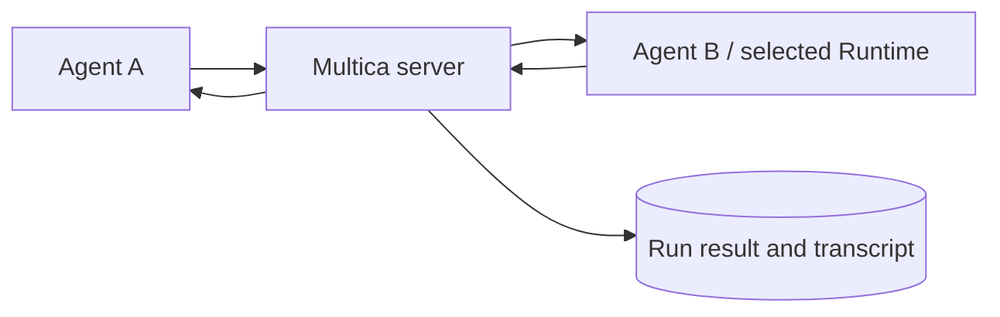

An Agent is the stable collaboration target. A Runtime is where that Agent currently executes, and a Run is one concrete execution. Agents on the same Multica server use the same collaboration API as Agents on different machines.



Use the explicit operation that matches the intent:

```bash
multica agent collaborate delegate MUL-123 reviewer --content "Review the auth changes" --request-id review-1
multica agent collaborate append RUN_ID --content "Check the error mapping" --request-id append-1
multica agent collaborate next RUN_ID --content "Continue in the next turn" --request-id next-1
multica agent collaborate read RUN_ID --view final
multica agent collaborate watch RUN_ID --request-id watch-1
multica agent collaborate stop RUN_ID --request-id stop-1
```

`append` only targets the named running Run. If it cannot accept input, Multica returns a conflict instead of silently creating a follow-up. `delegate` starts an independent Run; `next` creates a later turn. Reuse the same `--request-id` after a network timeout. Reusing it with different content or a different target is rejected.

An accepted operation is not a completed Run. Read the Run or register a terminal watch. If an Agent is waiting for another Agent, it should finish its current Run so the execution slot is available; the terminal event starts the ordinary follow-up Run.

Notifications are content-free wakeups. The durable Run input, transcript, terminal result, permissions, and execution identity are authoritative. Queued work follows an Agent when its Runtime binding changes; a dispatched or running Run stays with its actual Runtime.
