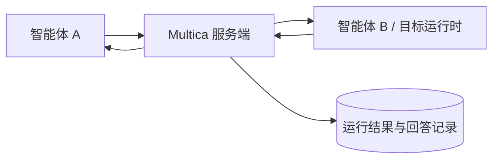

智能体是稳定的协作对象，运行时是它当前执行的位置，Run（API 中为 `task_id`）是一次具体执行。同一个 Multica 服务端中的不同运行时，使用与跨机器协作相同的接口。



```bash
multica agent collaborate delegate MUL-123 reviewer --content "Review the auth changes" --request-id review-1
multica agent collaborate append RUN_ID --content "Check the error mapping" --request-id append-1
multica agent collaborate next RUN_ID --content "Continue in the next turn" --request-id next-1
multica agent collaborate read RUN_ID --view final
multica agent collaborate watch RUN_ID --request-id watch-1
multica agent collaborate stop RUN_ID --request-id stop-1
```

`append` 只向指定的运行追加输入。目标不能接收输入时返回冲突，不会静默改成下一轮。`delegate` 创建独立运行，`next` 创建后续轮次。网络超时后沿用同一个 `--request-id` 重试；相同请求键配合不同内容或目标会被拒绝。

“请求已受理”不等于 Run 已完成。读取目标 Run，或注册终态监听。智能体等待另一个智能体时，应结束自己的当前 Run，释放执行名额；终态事件到达后，平台再创建普通后续运行。

通知只负责唤醒，不携带正文。持久化的输入、回答记录、终态结果、权限和执行身份才是事实来源。排队中的工作会跟随智能体改绑运行时；已经派发或运行中的 Run 会留在实际执行它的运行时。
