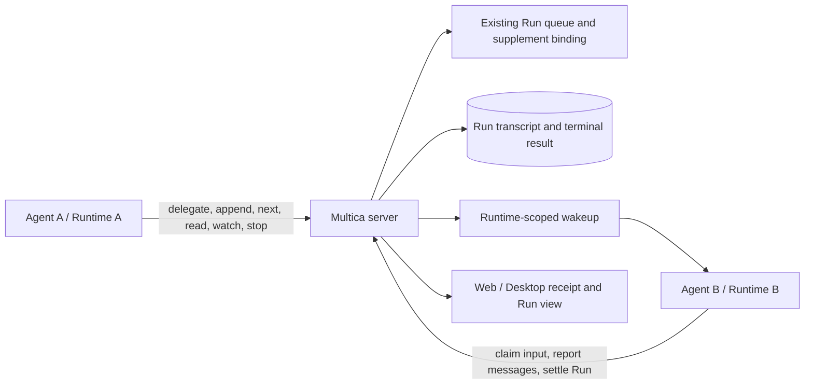
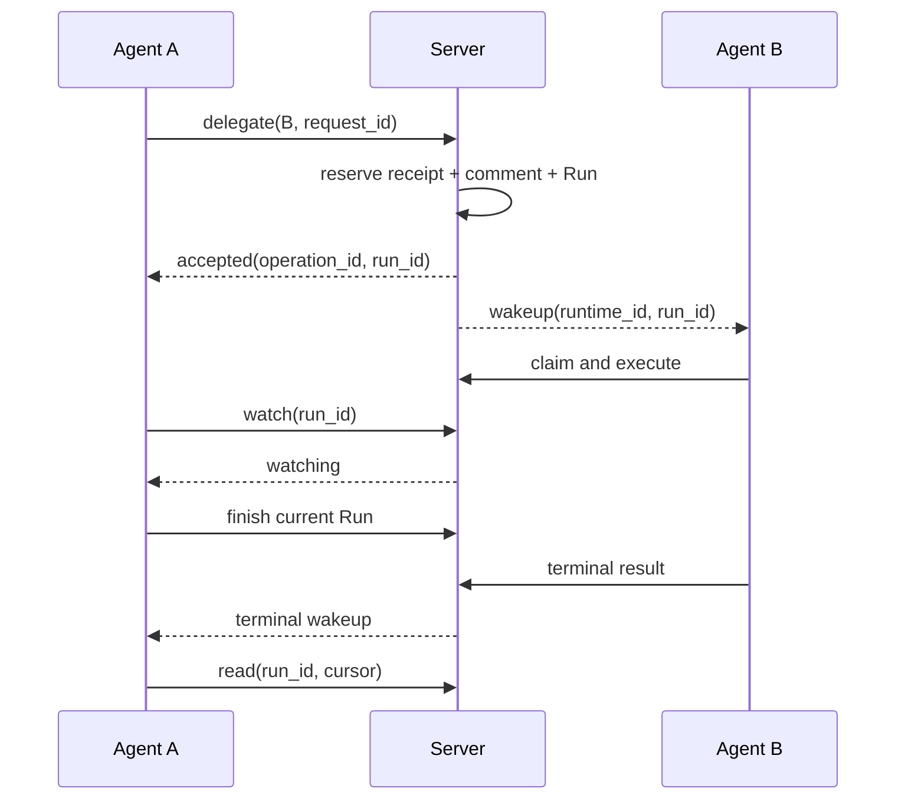

# Agent collaboration across runtimes

Agent is the stable collaboration address. Runtime is the execution location
selected by that Agent, and Run is the concrete execution that owns a provider
session. Two Agents on the same Multica server use the same server-side path as
Agents on different machines; no pairwise Runtime bridge is configured.

The design follows the useful part of `gary-ai-link`: remote session commands
are asynchronous, accepted work has a durable receipt, and transcripts are
read on demand. That project does not stream tokens through its relay. Multica
uses WebSocket or Redis notifications only as a content-free wakeup; durable
Run messages and terminal results remain authoritative.

## Commands

| Command | Effect | Failure rule |
| --- | --- | --- |
| `delegate` | Creates a fresh Run for the target Agent | Never merges into an unrelated pending Run |
| `append` | Adds input to one named running Run | A finished or unsupported Run returns a conflict; it never becomes `next` |
| `next` | Creates the next turn for the same Agent/issue context | It is a separate Run and may be deferred until capacity is available |
| `read` | Reads bounded answer chunks by cursor | The cursor advances only over returned characters |
| `watch` | Registers a terminal event wakeup | The caller must finish its current Run to release its slot |
| `stop` | Requests cancellation through normal settlement | `stop_requested` is not proof that the process has exited |

Each write includes `client_request_id`. The server stores a SHA-256 payload
fingerprint with the operation receipt. Reusing a key with the same payload
returns the original receipt; reusing it with different target, mode or content
returns a conflict. A delegate or strict append inserts the receipt, comment,
Run, and supplement binding in one transaction. The receipt stores links only;
it does not duplicate a transcript or create a second executor.

## Runtime movement

Queued and deferred Runs follow the Agent when its Runtime binding changes.
Claimed, dispatched, and running Runs retain their execution identity and stay
on the original Runtime until completion or confirmed loss. A WebSocket reconnect
does not revoke a live worker. Execution grants and reconciliation decide
whether a worker still owns a Run.

## Result reads and efficiency

`GET /api/tasks/{taskId}/answers` returns only text and error messages. Pages
are limited to 50 logical chunks and approximately 48 KiB of encoded answer
content. A long message continues with a character cursor, so Unicode text and
escaped JSON cannot silently lose a suffix. `view=final` reads the authoritative
terminal `result.output` or error separately from the transcript. This covers
the interval where a worker has settled the Run but its last local transcript
batch has not arrived.

The wakeup frame contains only Runtime and exact execution identity. It carries
no prompt, content, authorization, or result. Duplicate or lost hints are safe:
the worker claims durable input and its normal polling path remains the recovery
mechanism. Control traffic is bounded and must not be used for token streaming.

## Authorization and code handoff

Read, send, append, watch, and stop are separate checks. Agent-to-Agent calls
retain the original human originator for invocation policy; Runtime ownership is
never substituted for that human. Private Agents do not become callable merely
because both Runtimes share a server. A path on Runtime A is not sent as a path
to Runtime B; handoffs use issue, repository, branch, commit, patch, or
permission-checked attachment references.

## Operational evidence

Measure p50/p95/p99 for durable acceptance, Worker wakeup, provider acceptance,
terminal wakeup, and cancellation cleanup. Run the matrix for same Runtime,
different Runtime, different API nodes, offline target, saturated capacity,
duplicate notification, lost receipt, reconnecting Worker, and a cursor after
retention. Correctness requires one provider turn per request, replayable final
receipts, no silent cursor gaps, no false stopped state, and no source-slot
deadlock in A → B → A with capacity one.
